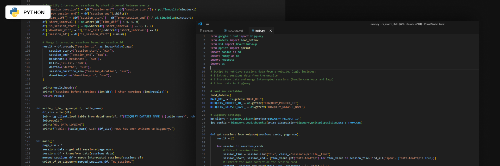
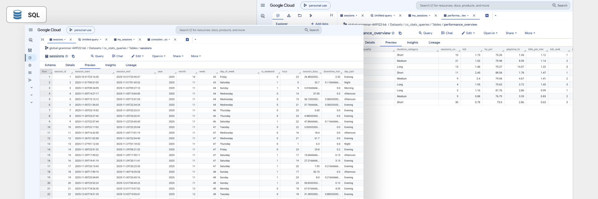
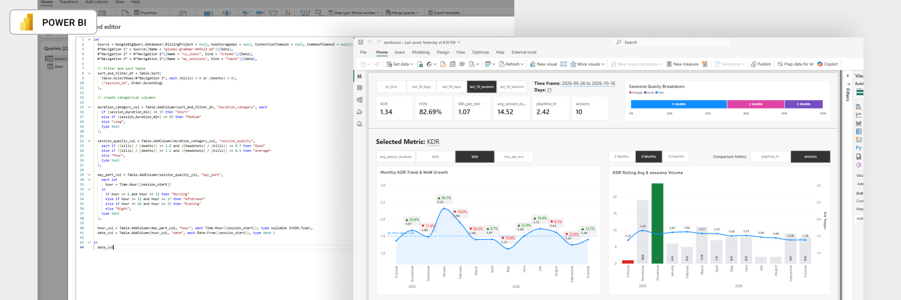
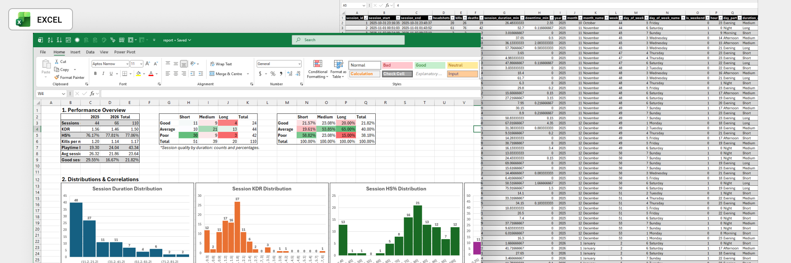

An end-to-end analytics project using my gaming session stats from a Counter-Strike: Source server. The project covers extracting and storing the data for analysis, using popular analytical tools for exploring overall stats, performance trends over time, and playtime habits.

 

## Project Workflow

Script that extracts gaming session stats from the server’s website and stores them in BigQuery. Used Requests and Beautiful Soup for scraping, pandas for transformation, and the Google Cloud BigQuery client to load the data.

[See more →](https://github.com/gnoevoy/cs_source_stats/tree/main/python_script)

-----

Queries to analyze overall performance, playtime habits, and monthly trends. The SQL models were developed with the dbt extension.

[See more →](https://github.com/gnoevoy/cs_source_stats/tree/main/sql_queries)

-----

An interactive dashboard for analyzing gaming performance over time. Used Power Query (M) to prepare the data, DAX measures and calculation groups to create metrics and compare periods.

[See more →](https://github.com/gnoevoy/cs_source_stats/tree/main/power_bi_dashboard)

-----

A report for exploring gaming stats. Used formulas and calculated columns to compute session metrics, PivotTables to summarize results, and charts and conditional formatting to highlight patterns.

[See more →](https://github.com/gnoevoy/cs_source_stats/tree/main/excel_report)

 

## Planned Features

- **Track leaderboard history.** Collect stats for top-ranked players, track changes in rankings and performance over time, and extend the SQL, Excel, and Power BI analyses.
- **Automate the data pipeline.** Run the code in Google Cloud on a schedule to collect new data.
- **Add on-demand AI insights.** Use AI to summarize results from SQL, Excel, and Power BI and highlight key trends when asked.